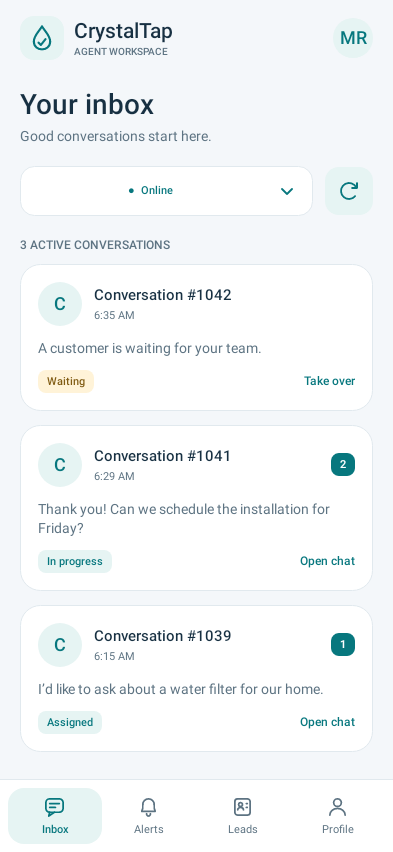
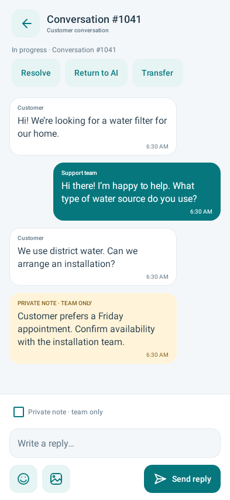
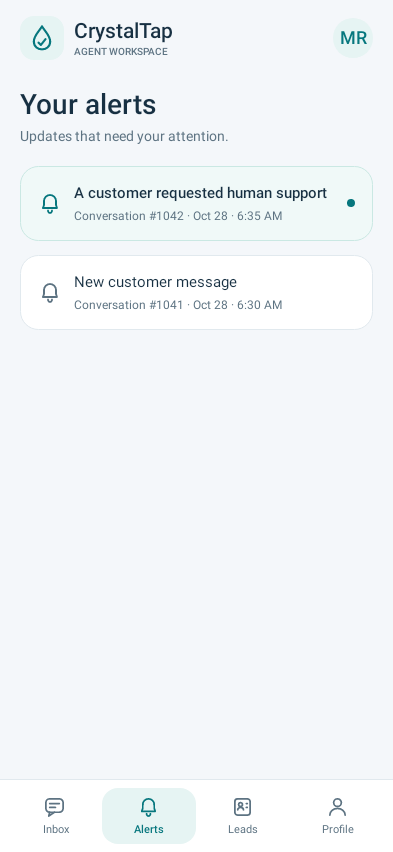
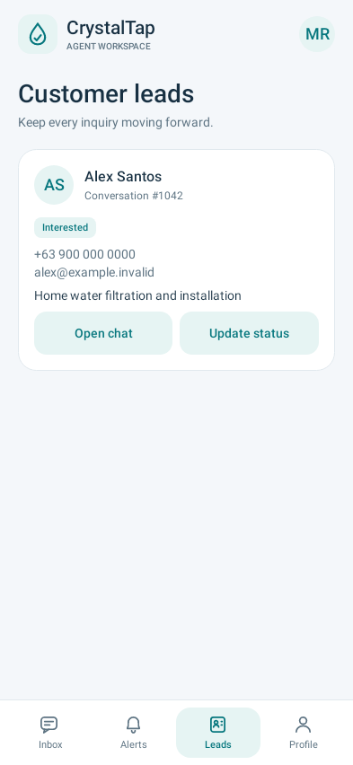

# CrystalTap Agent 0.1.2 interface

Install [the signed Android 0.1.2 APK](../downloads/android/CrystalTap-Agent-0.1.2.apk?raw=true) over your existing CrystalTap app. This UI update works with WordPress plugin 0.2.1 and uses the same signing identity as 0.1.0/0.1.1.

## What changed

- A consistent teal, white and navy palette, clearer typography, rounded cards and stroke icons drawn natively.
- A persistent Inbox / Alerts / Leads / Profile navigation bar. Conversations have a dedicated back control and a fixed composer.
- Conversation cards with actual availability, status, timestamps and unread counts. Taking over an unassigned conversation still requires confirmation.
- Aligned customer/support bubbles, distinct amber private notes, safe links, private photos, emoji controls and a visible sending state. New messages follow the bottom only when you are already there, so reading older history is not interrupted.
- Grouped notification tests, sound settings, website delivery information, alert preferences, quiet hours and account settings.
- System font scaling, local-time timestamps, content descriptions, visible focus/ripple behavior and 48dp primary action targets.

## Rendered native previews

These images render the actual Android views with Robolectric's native graphics mode. Names, messages and counters are synthetic fixtures; no customer data, credentials, website requests or live notifications are involved. They are not photographs or physical-device captures.

| Inbox | Conversation |
| --- | --- |
|  |  |

| Alerts | Leads |
| --- | --- |
|  |  |

[Sign in](images/android-0.1.2/sign-in.png) · [Profile](images/android-0.1.2/profile.png) · [Compact phone with larger text](images/android-0.1.2/compact-chat.png)

## Validation

Run `python3 scripts/android_build.py --test`. The seven native rendering/interaction checks plus ten API/routing checks run as local JVM tests. The UI checks verify readable message widths, persistent navigation, unread/status content, claim confirmation, private-note controls, lead actions, draft protection while sending and a 320dp-wide layout with 130% text scaling. Previews are generated under `android/app/build/reports/ui/`.

The release APK builds, Android lint passes with warnings, and APK signature verification checks the output. The published APK's signing certificate is compared with 0.1.1 before distribution. The three separate instrumented device checks still require a working emulator; prior software-only cloud emulator boots did not complete. Keyboard/window-inset behavior on the POCO, actual speaker output and live Firebase timing require device testing.

No WordPress runtime, Firebase credentials, notification channel ID, bundled alert tone or background delivery payload is changed by this UI release.
